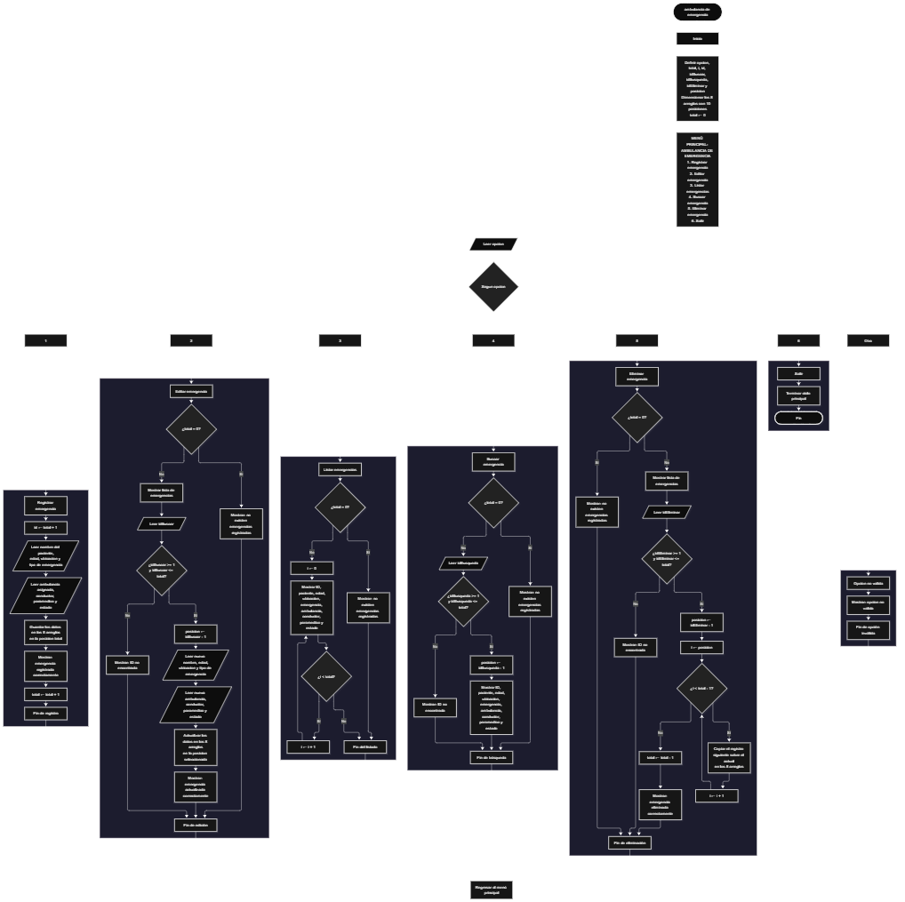

Este proyecto, llamado <b>ambulancia de emergencia</b>, fue desarrollado en <b>Java</b> como un ejercicio práctico para fortalecer la lógica de programación mediante la creación de un sistema de gestión de emergencias médicas desde la consola. El programa cuenta con un menú principal de seis opciones que permite <b>registrar, editar, listar, buscar y eliminar</b> emergencias, además de finalizar la ejecución del sistema. Cada emergencia almacena información como el nombre y la edad del paciente, la ubicación, el tipo de emergencia, la ambulancia asignada, el conductor, el paramédico y el estado de la atención, utilizando ocho arreglos paralelos con una capacidad de <b>10 posiciones cada uno durante la ejecución</b>. Durante su desarrollo se aplicaron conceptos fundamentales de programación, como variables, arreglos, estructuras condicionales, ciclos repetitivos y estructuras de selección, además de procesos para buscar, modificar, eliminar y organizar registros. Este proyecto permite poner en práctica los conocimientos adquiridos en Java y sirve como base para desarrollar sistemas de gestión más avanzados utilizando otros lenguajes y tecnologías.

<h2 align="center">⚙️ Funcionamiento del menú principal</h2>

### ➕ Registrar emergencia

La opción <b>1) registrar emergencia</b> permite almacenar una nueva emergencia médica en el sistema. Al iniciar el registro, el programa genera automáticamente un identificador mediante la expresión <b>total + 1</b> y muestra el ID correspondiente a la emergencia que se va a registrar. Después, solicita el <b>nombre del paciente, edad, ubicación de la emergencia, tipo de emergencia, ambulancia asignada, nombre del conductor, nombre del paramédico y estado de la atención</b>. Los datos se almacenan en la posición correspondiente de sus respectivos arreglos, utilizando la variable <b>total</b> como índice. Finalmente, muestra el mensaje <b>"Emergencia registrada correctamente."</b> y aumenta la variable <b>total</b> en uno para contabilizar el nuevo registro. Los arreglos tienen una capacidad de 10 posiciones, pero el código actual no incluye una validación que impida superar ese límite.

### ✏️ Editar emergencia

La opción <b>2) editar emergencia</b> permite modificar la información de una emergencia previamente registrada. Primero, el programa comprueba si existen emergencias almacenadas mediante la variable <b>total</b>. Si no hay registros, muestra el mensaje <b>"No existen emergencias registradas."</b>. En caso contrario, presenta una lista con el ID, paciente, edad, ubicación, tipo de emergencia, ambulancia, conductor, paramédico y estado de cada registro. Después, solicita el ID de la emergencia que se desea editar y comprueba que esté dentro del rango permitido mediante la condición <b>idBuscar &gt;= 1 && idBuscar &lt;= total</b>. Si la selección es válida, calcula la posición correspondiente restando uno al ID mediante <b>posicion = idBuscar - 1</b>. A continuación, solicita nuevamente los ocho datos de la emergencia y actualiza directamente los valores almacenados en sus respectivos arreglos. Finalmente, muestra el mensaje <b>"Emergencia actualizada correctamente."</b>. Si el ID introducido no corresponde a una emergencia registrada, presenta el mensaje <b>"ID no encontrada."</b>.

### 📋 Listar emergencias

La opción <b>3) listar emergencias</b> permite visualizar todas las emergencias registradas actualmente en el sistema. Antes de mostrar la información, el programa comprueba si la variable <b>total</b> es igual a cero. Si no existen registros, presenta el mensaje <b>"No existen emergencias registradas."</b>. Si hay emergencias disponibles, utiliza un ciclo <b>for</b> para recorrer los arreglos desde la primera posición hasta el número total de registros almacenados. Durante el recorrido, muestra el ID, nombre del paciente, edad, ubicación, tipo de emergencia, ambulancia asignada, conductor, paramédico y estado de la atención. El identificador se presenta mediante la expresión <b>i + 1</b>, que permite mostrar el número correspondiente a cada posición. Esta función facilita consultar todas las emergencias sin necesidad de buscarlas individualmente.

### 🔎 Buscar emergencia

La opción <b>4) buscar emergencia</b> permite localizar una emergencia médica mediante su ID. Primero, el programa comprueba si existen emergencias registradas. Si no hay registros, muestra el mensaje <b>"No existen emergencias registradas."</b>. En caso contrario, solicita el identificador de la emergencia que se desea buscar mediante la variable <b>idBusqueda</b>. Después, comprueba que el número introducido se encuentre dentro del rango permitido utilizando la condición <b>idBusqueda &gt;= 1 && idBusqueda &lt;= total</b>. Si el ID existe, calcula su posición mediante <b>posicion = idBusqueda - 1</b> y muestra la información completa de la emergencia encontrada: paciente, edad, ubicación, tipo de emergencia, ambulancia, conductor, paramédico y estado de la atención. Si el identificador no corresponde a ningún registro, presenta el mensaje <b>"ID no encontrada."</b>.

### 🗑️ Eliminar emergencia

La opción <b>5) eliminar emergencia</b> permite eliminar una emergencia registrada mediante su ID. Primero, el programa comprueba si existen emergencias almacenadas. Si el sistema no contiene registros, muestra el mensaje <b>"No existen emergencias registradas."</b>. Si hay emergencias disponibles, presenta una lista con los datos de cada registro. Después, solicita el ID de la emergencia que se desea eliminar y verifica que esté dentro del rango permitido mediante la condición <b>idEliminar &gt;= 1 && idEliminar &lt;= total</b>. Si la selección es válida, calcula la posición correspondiente mediante <b>posicion = idEliminar - 1</b> y comienza el proceso de eliminación. Para mantener los registros organizados, utiliza un ciclo <b>for</b> que desplaza una posición hacia atrás los datos de las emergencias posteriores en los ocho arreglos: <b>pacientes, edades, ubicaciones, emergencias, ambulancias, conductores, paramedicos y estados</b>. Posteriormente, disminuye la variable <b>total</b> en uno y muestra el mensaje <b>"Emergencia eliminada correctamente."</b>. El código no limpia explícitamente la última posición que queda libre después de la eliminación.

### 🚪 Salir del menú principal

La opción <b>6) salir</b> está destinada a finalizar la ejecución del programa y muestra el mensaje <b>"Gracias por utilizar Ambulancia de Emergencia."</b>. El menú principal se encuentra dentro de una estructura repetitiva <b>do-while</b>, que mantiene el programa en funcionamiento mientras se realizan las operaciones disponibles. Cuando el usuario selecciona la opción <b>6</b>, la condición <b>opcion != 6</b> deja de cumplirse y el ciclo finaliza. Finalmente, se utiliza la instrucción <b>entrada.close()</b> para cerrar el objeto Scanner y terminar la ejecución del programa.

<h2 align="center">🧠 Temas aplicados en el proyecto</h2>

### 📦 Variables

En este proyecto se utilizan variables para almacenar la opción seleccionada en el menú, controlar la cantidad de emergencias registradas, generar los identificadores, recorrer los arreglos y seleccionar las emergencias que se desean editar, buscar o eliminar. Cada variable cumple una función específica dentro de las operaciones de gestión de emergencias médicas.

🔢 **Opcion:** Almacena la opción seleccionada por el usuario en el menú principal.

📊 **Total:** Almacena la cantidad actual de emergencias registradas.

🔄 **I:** Funciona como contador en los ciclos <b>for</b> y permite recorrer los arreglos para mostrar o reorganizar los registros.

🆔 **Id:** Almacena el identificador generado para la nueva emergencia durante el registro.

✏️ **IdBuscar:** Almacena el ID introducido por el usuario para seleccionar la emergencia que desea editar.

🔎 **IdBusqueda:** Almacena el ID utilizado para localizar una emergencia registrada.

🗑️ **IdEliminar:** Almacena el ID de la emergencia que se desea eliminar.

📍 **Posicion:** Almacena la posición del arreglo correspondiente al ID seleccionado, calculada restando uno al identificador.

### 🗃️ Arreglos

En este proyecto se utilizan ocho arreglos relacionados con la información de cada emergencia médica. Cada arreglo tiene una capacidad de <b>10 posiciones</b> y utiliza el mismo índice para representar los datos correspondientes a un mismo registro. Por ejemplo, la información de una emergencia almacenada en la posición <b>0</b> se encuentra distribuida entre <b>pacientes[0], edades[0], ubicaciones[0], emergencias[0], ambulancias[0], conductores[0], paramedicos[0] y estados[0]</b>. Esta organización permite recorrer, buscar, modificar, mostrar y eliminar las emergencias de manera ordenada.

👤 **Pacientes[10]:** Almacena los nombres de los pacientes registrados.

🔢 **Edades[10]:** Almacena las edades de los pacientes.

📍 **Ubicaciones[10]:** Almacena las ubicaciones donde ocurren las emergencias.

🚨 **Emergencias[10]:** Almacena los tipos de emergencia registrados.

🚑 **Ambulancias[10]:** Almacena las ambulancias asignadas a cada emergencia.

🚗 **Conductores[10]:** Almacena los nombres de los conductores asignados.

🩺 **Paramedicos[10]:** Almacena los nombres de los paramédicos asignados.

📋 **Estados[10]:** Almacena el estado de atención de cada emergencia.

### 🔀 Estructuras condicionales

En este proyecto se utilizan las estructuras <b>if</b> y <b>else</b> para comprobar si existen emergencias registradas antes de realizar determinadas operaciones, validar que el ID introducido por el usuario corresponda a un registro existente y determinar si se puede continuar con los procesos de edición, búsqueda y eliminación. Estas condiciones permiten que el programa responda de manera diferente según la cantidad de registros almacenados y el resultado de cada validación.

### 🔄 Estructuras repetitivas

En este proyecto se utilizan los ciclos <b>for</b> y <b>do-while</b>. Los ciclos <b>for</b> permiten recorrer los arreglos para mostrar las emergencias registradas y presentar sus datos durante las operaciones de edición y eliminación. También se utilizan para desplazar la información de los registros posteriores hacia la izquierda cuando se elimina una emergencia. Por otro lado, el ciclo <b>do-while</b> mantiene activo el menú principal para que el usuario pueda ejecutar diferentes operaciones hasta seleccionar la opción de salida.

### 🎯 Estructura switch

El programa evalúa el valor almacenado en la variable <b>opcion</b> mediante la estructura <b>switch</b> y ejecuta el bloque de instrucciones correspondiente. Cada caso representa una operación específica del sistema: <b>registrar, editar, listar, buscar, eliminar o salir</b>. También se utiliza el bloque <b>default</b> para mostrar el mensaje <b>"Opcion no valida."</b> cuando el usuario introduce un número que no corresponde a ninguna de las opciones definidas en el menú.

### 🔢 Dimensionamiento de arreglos

El programa utiliza la creación de arreglos en Java mediante la instrucción <b>new</b> para establecer la capacidad de los espacios que almacenan la información de las emergencias. Se definieron <b>10 posiciones</b> para cada uno de los ocho arreglos, lo que permite almacenar hasta 10 registros dentro de la capacidad disponible. La cantidad de posiciones ocupadas se controla mediante la variable <b>total</b>, por lo que las operaciones recorren los registros comprendidos entre la primera posición y el total actual de emergencias. El código actual no comprueba la capacidad disponible antes de realizar un nuevo registro.

### 🔄 Reorganización de registros

Cuando se selecciona una emergencia para eliminarla, el programa utiliza un ciclo <b>for</b> que comienza en la posición seleccionada y continúa mientras <b>i &lt; total - 1</b>. En cada repetición, los datos de la posición siguiente se copian sobre la posición actual en los ocho arreglos: <b>pacientes, edades, ubicaciones, emergencias, ambulancias, conductores, paramedicos y estados</b>. Después, la variable <b>total</b> disminuye en uno para actualizar la cantidad de emergencias registradas. De esta manera, los registros posteriores ocupan las posiciones disponibles sin dejar espacios vacíos entre los registros activos.

<h2 align="center">¿Cómo se implementaron las operaciones CRUD en el proyecto?</h2>

Las operaciones <b>CRUD</b> se implementaron mediante las opciones del menú principal, permitiendo administrar las emergencias médicas registradas. La operación <b>crear</b> corresponde a <b>registrar emergencia</b>, donde se introducen los datos de un nuevo paciente y su situación; <b>leer</b> se realiza mediante las opciones <b>buscar emergencia y listar emergencias</b>, que permiten consultar los registros almacenados; <b>actualizar</b> corresponde a <b>editar emergencia</b>, donde se modifican los datos de una emergencia existente; y <b>eliminar</b> se realiza mediante la opción <b>eliminar emergencia</b>, que retira un registro y reorganiza los arreglos. Estas operaciones utilizan variables, arreglos, condicionales y ciclos para gestionar la información almacenada temporalmente durante la ejecución del programa.

<h2 align="center">Diagrama de flujo del proyecto</h2>

<h2 align="center">🛡️ Validaciones del programa</h2>

### 📭 No existen emergencias registradas

Esta validación se utiliza en las opciones de <b>editar, listar, buscar y eliminar emergencias</b>. El programa comprueba si la variable <b>total</b> es igual a <b>0</b> y, si no existen registros almacenados, muestra el mensaje <b>"No existen emergencias registradas."</b>. Esta comprobación evita continuar con las operaciones que necesitan información almacenada cuando el sistema está vacío.

### 🔢 Selección de emergencias

El programa utiliza las variables <b>idBuscar, idBusqueda e idEliminar</b> para identificar la emergencia que se desea editar, buscar o eliminar. Antes de realizar estas operaciones, comprueba que el número introducido sea mayor o igual a <b>1</b> y menor o igual al valor de <b>total</b>. Si la selección está dentro del rango permitido, calcula la posición correspondiente restando uno al ID. Si el identificador no corresponde a una emergencia registrada, muestra el mensaje <b>"ID no encontrada."</b>. Esta validación evita modificar, consultar o eliminar posiciones que no corresponden a registros activos.

### ⚠️ Capacidad de los arreglos

Los ocho arreglos utilizados en el proyecto tienen una capacidad de <b>10 posiciones</b>. Sin embargo, el código actual no incorpora una condición que compruebe si existe espacio disponible antes de registrar una nueva emergencia. Por este motivo, si se intenta registrar un registro adicional cuando los arreglos ya tienen sus 10 posiciones ocupadas, el programa puede generar un error al intentar acceder a una posición fuera de los límites del arreglo.

### 🔄 Organización de los registros

Esta operación se realiza cuando el usuario elimina una emergencia. El programa desplaza los datos de los registros posteriores una posición hacia atrás en los ocho arreglos y disminuye la variable <b>total</b> en uno. Aunque los registros activos quedan organizados, el código no limpia explícitamente los valores de la última posición que queda libre después de la eliminación. Las operaciones del programa utilizan únicamente las posiciones comprendidas dentro del valor actual de <b>total</b>.

### ⚠️ Opción inválida

La estructura <b>switch</b> incluye el bloque <b>default</b>, que muestra el mensaje <b>"Opcion no valida."</b> cuando el usuario introduce un número que no corresponde a ninguna de las opciones definidas en el menú principal. Esta condición permite informar al usuario cuando selecciona una opción no disponible y mantiene el funcionamiento del menú principal.

<h2 align="center">🎯 Objetivo del proyecto</h2>

El objetivo principal de este proyecto es fortalecer la <b>lógica de programación</b> mediante el desarrollo de un sistema de gestión de emergencias médicas en <b>Java</b>. A través de su construcción se busca aplicar los conocimientos adquiridos sobre variables, arreglos, estructuras condicionales, ciclos repetitivos y estructuras de selección, integrándolos para resolver un problema de manera organizada. Además, el proyecto permite comprender cómo registrar, consultar, modificar y eliminar información en una aplicación de consola, utilizando arreglos paralelos para administrar los datos de pacientes y la asignación de recursos de atención. De esta manera, se establece una base para desarrollar sistemas de gestión más completos con otros lenguajes y tecnologías.

